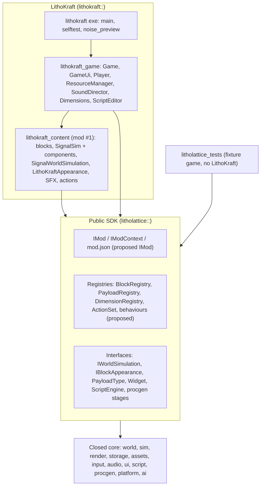
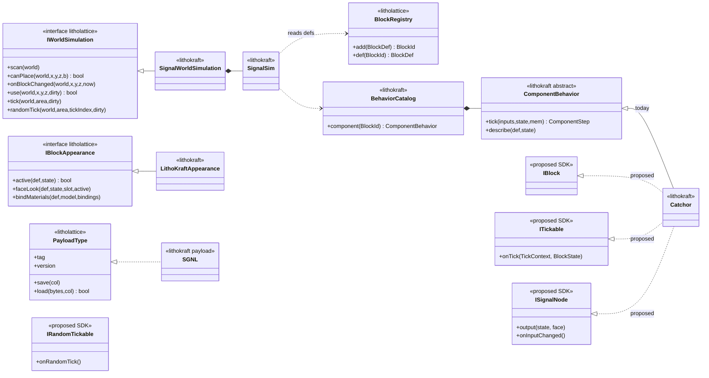
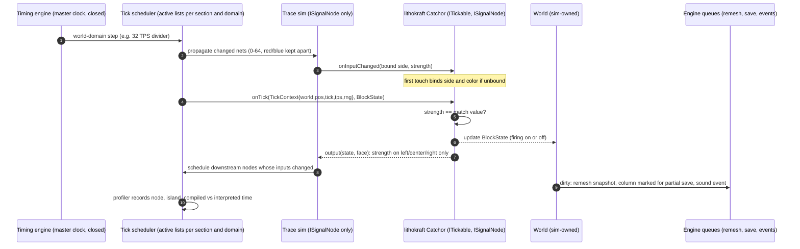

# LithoKraft: Architecture Brief from a Mod Developer's Seat

**CONFIDENTIAL: for Elfie and JD only. Do not forward or publish.**

October 10, 2026. Prepared for JD's code-structure review with Elfie.
Scope: **LithoKraft only** (namespace `lithokraft::`, folder `LithoKraft/`) and how it uses the **public** LithoLattice SDK (namespace `litholattice::`). Closed engine internals (renderer internals, sim thread implementation, storage codec, the Daemon model, AI internals) are covered only at the level of their public interfaces.

**How to read this.** The live repo is on JD's PC (`D:\LithoLattice`, game in `LithoKraft\`), and this brief was written from the docs and review notes on the box, not from the live code. Every item carries a status tag:
- **[EXISTS]**: in the code, per the docs or the build log.
- **[PARTIAL]**: the mechanism exists, but its SDK form does not yet.
- **[PROPOSED]**: design only.
- **[PROPOSAL FOR REVIEW]**: new in this brief, for JD and Elfie to decide (section 5).

Names are taken from the docs. Where a doc says "check the header," this brief stays at the interface level and does not guess at a function name.

**Sources:** `docs/SDK.md` (engine HEAD `e5dac77`), `reviews/architecture-diagrams-2026-10-09.md` (refreshed for the SDK split at `2f33e6e`), `reviews/fix-build-log-2026-10-09.md`, `reviews/code-review-2-2026-10-09.md`, `brief.md`, `consult/from-elfie/master-builder-brief-2026-10-10.md`, `consult/from-elfie/sdk-decisions-2026-10-09.md`, and the two Oct 10 Elfie updates. `UI.md`, `RESOURCE_PACKS.md` and `PROCGEN.md` were read from a repo snapshot on the box taken at `bd3bba0`, which is **before** the SDK split. **`docs/SAVE_FORMAT.md` and `docs/CHANGELOG.md` are not on the box.** The build log says CHANGELOG exists in the repo (commit `3d57040`), so save details here come from SDK.md section 2.9 and the review notes.

---

## 1. Overview

LithoKraft is **mod #1** on the LithoLattice engine, set up the way the Half-Life SDK was. The engine is a closed library that holds no game content (only `kAir` and generic block types). Modders get public headers, engine libraries, docs, and the source of a sample game. LithoKraft is held to the same public API as any third-party mod: **if LithoKraft needs something a third-party mod can't get, that's an SDK bug.** SDK parity is checked at review time; it doesn't block commits. In v1, native mods are **statically linked** into one build (one compiler, one CRT, so C++20 standard-library types are allowed across the API). The `IMod` boundary is designed as if DLL mods are coming: pure virtual interfaces, no STL across the boundary, an `extern "C"` factory, and engine-owned allocation. That way the later switch to DLLs is a packaging change, not a rewrite. Every dependency arrow points from the game to the engine. A test target, `litholattice_tests`, builds and runs the engine with no game linked, using a fixture game.

---

## 2. LithoKraft folder and module map

Three CMake targets. Each one depends only on the targets listed below it and on the engine.

```
LithoKraft/
  CMakeLists.txt
  mod.json                       [EXISTS, baa6614] LithoKraft's own manifest (ModManifest schema 1)
  README.md, brief.md
  src/
    app/        -> lithokraft (LithoKraft.exe)
      main.cpp                   owns Display (Window + IRenderer), ResourceManager, AudioEngine, JobPool, InputSystem, Game
      selftest.cpp               --selftest runner (headless; 283 PASS at last count)
      noise_preview.*            --noise-preview (worldgen graph to PNG)
      scripts_dir.*              picks the AngelScript folder (dev tree vs. next to the exe)
    game/       -> lithokraft_game  ("the shell": wiring, player, UI, resources)
      include/lithokraft/game/engine.h   one using-directive that imports litholattice:: into game code
      game.cpp                   Game: owns ScriptEngine, GameUi, SoundDirector, DimensionRegistry, Player, SimThread per active dimension
      dimensions.cpp, structures.cpp     createDimensions(): Wafer, Organic World (+ demo structures)
      resource_manager.cpp       PackStack + ResourceSet + ShaderLibrary; reload(), apply(IRenderer&), materials()
      game_ui.cpp, controls_panel.cpp, ui_input_bridge.cpp   HUD, hotbar, inventory, look-at inspector
      ui_script_bindings.cpp     implements ui::IScriptHost; registers the ui_* script API
      script_editor.cpp          F10 in-game editor (staged hot reload)
      sound_director.cpp         sim sound events -> AudioEngine commands
    content/    -> lithokraft_content  ("the mod": everything a third party would replace)
      blocks.h / blocks.cpp      block table (BlockDef rows) + BlockId constants + namespaced names
      component.h                ComponentBehavior, ComponentInputs, ComponentStep, ComponentMemory
      components/*.cpp           component classes (e.g. logic_components.cpp)
      catalog.cpp                BehaviorCatalog: behavior name -> behavior object
      SignalSim + SignalWorldSimulation   the Trace sim; implements IWorldSimulation
      appearance.cpp             LithoKraftAppearance : IBlockAppearance (+ embedded torch/switch box models today)
      sfx.h, music.h             SFX/music definitions (AudioCommand notes)
      action set + input contexts  ActionSet / ContextRules declarations
      content_selftest.cpp       per-component tests
  assets/                        game pack (pack stack level 2)
    pack.json, ui/theme.json, worldgen/wafer.json, worldgen/organic.json
    packs/pack_64 | pack_32/     art packs (level 3): manifest.json (art export), resources.json (generated), textures/, MODDING.md
  config/input.json              user bindings (gitignored, created from defaults)
  scripts/*.as                   AngelScript (hello.as; onLoad() hook)
  logs/lithokraft.log
```

Notes for the reviewer:
- The `content/` file names (`blocks.cpp`, `component.h`, `catalog.cpp`, `logic_components.cpp`, `content_selftest.cpp`, `appearance.cpp`) come from SDK.md section 7, the diagrams review and code review 2. The rest of `content/` is listed by the role the diagrams give it, not by file name.
- `LithoKraft/src/game/include/` also holds a leftover `vc/` folder from the Voxel Compute name (seen in the `bd3bba0` snapshot). It's worth checking whether it's still there.
- The pack stack, lowest priority first: engine base `assets/` (shaders), then the game pack `LithoKraft/assets/`, then the art pack, then mods (from `mods/`, mounted since `0c0575e`, then `--resource-pack` folders), then the player's pack.

---

## 3. Public engine interfaces LithoKraft implements or calls

| # | Area | SDK surface (`litholattice::`) | LithoKraft's side | Status |
|---|---|---|---|---|
| 3.1 | Mod lifecycle | `IMod { info(), onRegister(IModContext&), onWorldLoad(World&), onShutdown() }`, `ModInfo`, `LITHOLATTICE_MOD_ENTRY`; DLL form `llCreateMod(apiVersion, IModContext*)` | today `Game` / `main` wire the content up directly | IMod **[PROPOSED]**; DLL-ready boundary not started (deferred in the build log) |
| 3.2 | Block registry + namespaced IDs | `BlockRegistry::add(BlockDef) -> BlockId`, `def()`, `has()`, `hasAll()`, `findByTexture()`; row 0 = `kAir`; built once, then read-only | `blocks.cpp` fills one registry instance; names `lithokraft:<name>` | registry **[EXISTS]**; namespaced IDs, a `blocks.names` table and legacy migration **[EXISTS, 3d57040]**; explicit frozen IDs (not derived from the texture name) **[EXISTS, 3135e6f]** |
| 3.3 | Block properties | `BlockDef { name, flags, Shape {None, Cube, Cross, Slab, Custom}, tex, behavior, role, channel, tier }`; engine `BlockFlags`, with game bits from `kFirstGameFlag`; `CellState` (16-bit: `stOn`, `stValue`, facing via `makeState`, `kDirectional`) | the power-property set JD approved Oct 10: conductive, wire-carrying non-conductive (glass, frosted, ceramic), insulator/cuts trace, transparent/opaque, solid/half, wire-transparent, plus weak-only, color-filtered, heat-conductive, attenuating | `BlockDef` **[EXISTS]**; the new property flags are approved, but their encoding is **[PROPOSED]** (game bits vs. engine flags is open, Q4) |
| 3.4 | Sim + tick hooks | `IWorldSimulation`: `scan`, `canPlace`, `onBlockChanged`, `use`, `command(SimCommand)`, `tick(world, TickArea, dirty)`, `randomTick(...)` (stub), `activeCount`, `takeEvents`; `ClockDomain {name, hz, enabled, step}` | `SignalWorldSimulation` owns `SignalSim`; `SignalSim` uses `BehaviorCatalog` -> `ComponentBehavior::tick(inputs, state, mem) -> ComponentStep` (also `emitToward`, `use`, `describe`) | **[EXISTS]**. A generic `IBlockBehavior` / `BehaviorRegistry` in the SDK is **[PROPOSED]**; section 5 is the reviewed replacement |
| 3.5 | Random ticks | the `randomTick` hook on `IWorldSimulation`; per-block `IRandomTickHandler::onRandomTick(world, x, y, z, rng, dirty)`; 8 cells per 16^3 section per world tick, per-dimension rate, opt-in per block | no LithoKraft block uses it yet (candidates: Organic growth, heat decay) | mechanism **[EXISTS, 0b2a119]**, deterministic splitmix64 RNG per position and tick; the per-block registration form is **[PROPOSED]** in SDK.md, so check what `0b2a119` actually exposes |
| 3.6 | Attachables | attach face in `CellState` bits 13-15, `kAttachable`, `IWorldSimulation::canAttach`, pop-off when the support goes; JSON box models (`ll-box-1`, a glTF-concept subset) | torch, switch and button rules; box models embedded in `appearance.cpp` | **[EXISTS, 1c657fd, ad0ba58, a375ad3]**; `IAttachRules` / `onSupportRemoved` in the SDK **[PROPOSED]**; moving the box models to `LithoKraft/assets/models/*.json` is pending block JSON |
| 3.7 | Appearance | `IBlockAppearance { active, faceLook, meshCustom, bindMaterials }`; `BlockModel`, `FaceSlot`, `WirePiece`, `BlockMaterials` | `LithoKraftAppearance` | **[EXISTS]** |
| 3.8 | Resource packs + manifests | `ResourcePack`, `PackStack`, `TextureRegistry`, `ResourceLoader`, `ShaderLibrary`; `resources.json` (`format: "litholattice.resources"`, v1: `tile_size`, textures, animations, palettes, models with `faces` / `active` / `wire` / `palette` / `masks`) | `ResourceManager`; art `manifest.json` -> `tools/convert_pack_manifest.py` -> `resources.json`, never hand-edited | **[EXISTS]**; normal/height maps **[PROPOSED]** |
| 3.9 | UI layouts | `UiRoot`, `Widget`, `Theme` (`ui/theme.json`), JSON layouts via `buildWidget`, `ui::IScriptHost`, `IUiRenderer` (injected) | `GameUi`, `UiScriptBindings` (script API: `ui_text`, `ui_setText`, `ui_checked`, `ui_setChecked`, `ui_value`, `ui_setValue`, `ui_setVisible`, `ui_setEnabled`, `ui_show`, `ui_close`) | **[EXISTS]**; `WidgetFactory::registerType("mod:type", factory)` **[PROPOSED]** |
| 3.10 | Input actions | `ActionSet` (named actions, `ActionKind {Button, Axis2D}`), `ActionMap` / `Binding`, `InputContext` + `ContextRules`, `InputSystem` (`pressed`, `held`, `value`, `push`/`pop` context) | declares LithoKraft's action set and contexts (gameplay, `UiText`, keyboard typing capture) | **[EXISTS]**; namespaced action fragments from mods, with conflict reports (Alt+Enter reserved), **[PROPOSED]** |
| 3.11 | Save hooks | `PayloadType { tag (fourcc), version, save, load, migrate[v] }`, `PayloadRegistry`; partial saves driven by `SimThread::takeChangedColumns()`; `dirty` marks columns | registers the `SGNL` payload (component memory and timers); the engine owns `BLKS` | **[EXISTS]**; mod-scoped tags, a save manifest of mods and versions, and keeping unknown payloads verbatim **[PROPOSED]**. Payload callbacks run on the storage I/O thread against a column snapshot, never the live world |
| 3.12 | AngelScript bindings | `ScriptEngine` (`init`, `raw()`, `loadDirectory`, `reload` with staging, `callHook`, `callWithString`, 500 ms per-call budget, sandbox: `string` + `log` + whatever the game binds) | `Game::initScripts()` binds via `raw()->RegisterGlobalFunction(...)` (`currentDimension()`, `ui_*`); `onLoad()` hook | host **[EXISTS]**; a stable `ll::` + `<modid>::` script API, per-mod modules and full SDK bindings **[PROPOSED]** (not started) |
| 3.13 | Permissions | declared in `mod.json`: `world.write`, `ui.overlay`, `audio`, `net` (future), `native` (full trust), `save.payload`; a script calling an undeclared API fails with a logged error | LithoKraft is native, so full trust | **[PROPOSED]**. Decision 6: content packs load silently; script and native mods prompt and show which APIs and why |
| 3.14 | Dimensions / worldgen | `Dimension`, `DimensionRegistry` (`add`, `addAlias`, `find`), `ColumnGenerator::create(json, ...)`, procgen stage interfaces (`ITerrainStage`, `IFeature`, ...) | `createDimensions()` + `worldgen/*.json` (Wafer, Organic World today; Underwafer, Void and the Cosmic are planned as indices 0, 3, 4) | **[EXISTS]**; `NoiseNodeRegistry` / `StageRegistry` **[PROPOSED]** |

**Threading rules a mod developer must follow** (SDK.md section 5): registries are writable only during `onRegister` (main thread, at load). Sim hooks run on the sim thread: never block or do I/O, and report changes only through `dirty`. Worldgen and mesher code runs on job workers and must be pure. Payload code runs on the storage I/O thread against a snapshot. UI and scripts run on the main thread. The only ways across threads are the engine's queues.

---

## 4. Worked example: adding the Catchor end to end

**What it does** (Oct 10 rules): an exact-match decoder. It has a match value from 1 to 64, set with sneak + use. It fires only when it receives exactly that strength, whether steady or pulsed. It auto-connects to the **first** red or blue Trace that touches a side, and only if it has no connection yet. Once wired, its output is left, right or center (use cycles it), never up or down. A Catchor feeding a Redirector acts as that Redirector's input, and the Redirector gets the same left/right/center choice. The art already exists: batch 3 has `catchor_top`, `catchor_top_firing`, `catchor_front`, `catchor_front_firing`, `catchor_back`, `catchor_side`, `masks/catchor_readout_mask.png` (a 2-digit 7-segment readout) and `ui/icons/catchor.png`, with `face_layout: top+side+front+back`.

The two paths below are **today's in-tree path** (what LithoKraft does now) and the **SDK path** (what a third-party mod will do once block JSON and the mod loader land).

### Step 1: Definition

*Today [EXISTS path]:* append a `BlockDef` row in `LithoKraft/src/content/blocks.cpp` (name, flags such as `kSolid | kComponent | kDirectional`, `Shape::Cube`, tex `"catchor"`, behavior `"catchor"`) and an explicit `BlockId` / namespaced name `lithokraft:catchor` in `blocks.h`.

*SDK path [PROPOSED]:* block JSON. The fields follow the SDK.md section 7 sample. The `properties` and `settings` blocks are illustrative only, because the exact schema is open (Q3).

```json
[{
  "id": "lithokraft:catchor",
  "shape": "cube",
  "tex": "lithokraft:catchor",
  "behavior": "lithokraft:catchor",
  "flags": ["solid", "component", "directional"],
  "properties": { "conductive": false, "cutsTrace": true },
  "settings":   { "match": { "min": 1, "max": 64, "default": 1 },
                  "output": ["left", "center", "right"] }
}]
```

### Step 2: C++ component class

*Today [EXISTS path]:* a `ComponentBehavior` subclass in `components/`, registered in `catalog.cpp`. The sketch below uses only names that appear in SDK.md (`ComponentBehavior`, `tick`, `ComponentInputs`, `CellState`, `ComponentMemory`, `ComponentStep`, `describe`, `use`, `stOn`, the catalog `add`). Like SDK.md, it **leaves the exact helper names to `component.h`**, so the helper calls appear as comments:

```cpp
class Catchor final : public ComponentBehavior {
 public:
  ComponentStep tick(const ComponentInputs& in, CellState s, ComponentMemory& mem) const override {
    // 1. read the strength arriving on the one bound input side (steady, Pulsor packet or 1-tick pulse)
    // 2. fire = (strength == match value)          // match value lives in state or memory: open question Q5
    // 3. emit toward the chosen output side (left / center / right; never up/down), e.g. via emitToward
    // 4. return a ComponentStep that sets on/firing; the sim marks the cell dirty (remesh + save)
  }
  // use(): plain use cycles the output side; sneak+use steps the match value (UI panel optional)
  std::string describe(const BlockDef& d, CellState s) const override {
    return std::string(d.name) + (stOn(s) ? " (firing)" : " (idle)");   // + match value for the inspector
  }
};
// catalog.cpp: add("catchor", std::make_unique<Catchor>());
```

The **first-touch auto-connect** is a placement/topology rule, not tick logic. It belongs where the Trace sim reacts to block changes (`IWorldSimulation::onBlockChanged`, run by `SignalWorldSimulation`): when a Trace cell lands next to an unbound Catchor, record that side and color as the binding. Under the section 5 proposal this becomes `ISignalNode::onInputChanged`.

*SDK path [PROPOSAL FOR REVIEW]:* `lithokraft::Catchor : IBlock, ITickable, ISignalNode` (section 5).

### Step 3: Textures

1. Drop the PNGs into each art pack (`pack_64` and `pack_32`) under `textures/blocks/`, with entries in `manifest.json` (`block: "catchor"`, `face`, `state: default|firing`, `face_layout`). Batch 3 already did this.
2. Run `python tools/convert_pack_manifest.py LithoKraft/assets/packs/pack_64` (and the same for `pack_32`). It writes the `catchor` model into `resources.json`: `faces` {top, front, back, side}, `active` {top: firing, front: firing}, and `masks` {readout}.
3. **Engine work:** the readout mask is a **new mask role**. The chunk shader today knows wire `ring`, lamp `main`/`rim`, repeater `delay` and memory `value`. The 7-segment readout needs either an engine shader change or reuse of the memory `value` path. This is a good SDK-parity test: a third-party mod can't add a shader mask role today (Q6).
4. F9 hot-reloads the change in game. A missing texture shows the magenta/black checker and logs a line.

### Step 4: Self-test

Add cases to `content_selftest.cpp` and run `LithoKraft.exe --selftest` (headless, exits 0 on success):
- Exact match fires and off-by-one doesn't (for example, match 23: input 23 fires, 22 and 24 don't).
- A steady input, a Pulsor packet and a 1-tick pulse all fire.
- First-touch binding: place red Trace, then blue, and only red is bound. Breaking the Catchor and placing it again resets the binding.
- The output goes to left, center or right and never up or down. Use cycles it.
- Catchor -> Redirector hand-off gives the Redirector the same left/right/center choice.
- Save round-trip: the match value, binding and output side survive save and load (through `SGNL` or `CellState`, depending on Q5).
- Bit-identical sim hash across thread counts (the same determinism gate the engine already uses).

### Step 5: AngelScript exposure

- *Today [EXISTS]:* only what `Game::initScripts()` binds. Nothing Catchor-specific.
- *v1 [PROPOSED; decision 4: scripts run on the main thread only]:* scripts can **read and configure** a Catchor (query or set the match value and output side through world commands, and show a settings panel with `ui_show` and a `number` widget with min 1 and max 64). The command goes main -> sim through the engine queue (`SimThread::edit` / `SimCommand`), so scripts never touch sim state directly.
- *v2 [PROPOSED]:* sim-thread script components that implement the same interfaces as C++, under strict per-tick budgets and a circuit breaker (going over budget revokes sim access for the session and logs it). The SDK.md sketch shows the shape: a script class deriving from `ll::ComponentBehavior` and registered through `ctx.behaviors.add(...)` in `onRegister`. That is a **proposed** binding.

### Step 6: mod.json and save

LithoKraft's `mod.json` doesn't change for a new block. Saves need no new payload if the Catchor's state fits in `CellState` and `SGNL` memory. Namespaced IDs and the block-name table keep worlds valid if the load order changes.

---

## 5. Tick system OOD **[PROPOSAL FOR REVIEW; JD approved the direction Oct 10]**

**Principle.** Ticking belongs to LithoLattice's timing engine (the master clock, world TPS and clock domains, already **[EXISTS]** as `SimThread` + `ClockDomain`). A block doesn't inherit from one big base class. It **opts into small interfaces**. These are **inheritable public SDK interfaces** that mods implement in **C++ or AngelScript**. LithoKraft implements them exactly the way a third-party mod would.

### 5.1 Interfaces

| Interface | Purpose | Members (proposed) |
|---|---|---|
| `IBlock` | identity, properties, model | block properties (flags, shape, power properties), model/appearance binding |
| `ITickable` | scheduled or changed-driven logic | `onTick(TickContext&, BlockState&)` |
| `IRandomTickable` | random ticks (opt-in, per dimension) | `onRandomTick(...)` |
| `ISignalNode` | membership in the Trace graph | `output(state, face)`, `onInputChanged(...)` |

`TickContext` = { `world`, `pos`, `tick`, `tps`, `rng` }. The RNG is deterministic per position and tick, matching the existing splitmix64 random-tick RNG.

### 5.2 Flyweight data model

- One **shared behavior object per block type**: stateless and registered once in `onRegister`. This is what `BehaviorCatalog` already does in LithoKraft.
- A compact **per-placed `BlockState`**: the 16-bit `CellState` (on, value, facing, attach face) plus, where needed, a small memory record (today's `ComponentMemory`, saved through `SGNL`).
- This keeps memory flat for 10k+ components and lets the scheduler work over dense arrays.

### 5.3 Scheduler

- **Active-ticker lists per chunk section (16^3) and per tick domain**: world (32 TPS default), **beacon zones** (local 64/128/256), and **lithographed chips** (their own domain rate, up to the open TPS ceiling).
- The scheduler calls only blocks that are **scheduled** (delays, pulses) or whose **inputs changed**. Idle circuits cost nothing. This matches the event-driven Trace sim and the "skip when nothing changed" fix that took static scenes to 8192 TPS.
- Domain order stays as documented: chip domains first, then the world tick. Values cross between domains only at the world-tick boundary (latched pins).

### 5.4 Engine/game split

- **The Trace sim talks to `ISignalNode` only.** It never knows "Catchor" or "Memor," only nodes with outputs per face and input-change callbacks. That keeps the signal engine generic and LithoKraft's components as content.
- Open: is the Trace (net flood-fill, 0-64 strength, red/blue channels) engine or game? Today `SignalSim` is in `lithokraft_content`. With `ISignalNode`, the graph solver could move into the SDK as a generic signal service, with red/blue as game-defined channels (Q1).

### 5.5 AngelScript

Script classes implement the same four interfaces through one binding layer that mirrors the C++ SDK. Under decision 4, v1 script tickables are main-thread only (or command-driven), and v2 adds sim-thread script tickables with budgets and a circuit breaker.

### 5.6 Profiling **[PROPOSAL FOR REVIEW]**

When tickables are compiled into a signal graph or JIT (lithography), the profiler reports:
- **per-node cost** and **per-island cost** (an island is a connected sub-graph or chip),
- **active counts** per section, per domain and per node type,
- **compiled vs. interpreted time** (how much of each tick runs in JIT'd chips vs. interpreted behaviors),
- attribution per **mod** (namespace) so a slow third-party component is visible.

This gives full visibility into where performance goes. It plugs into the existing F3 overlay and `perf` log line (TPS, tick ms, budget %, dropped ticks), and the deterministic replay makes a profile reproducible.

### 5.7 Example

```
lithokraft::Catchor : IBlock, ITickable, ISignalNode
  IBlock       -> properties (solid, component, directional, cuts trace), model "catchor"
  ISignalNode  -> onInputChanged: first-touch binding; output(state, face): strength on the chosen side only
  ITickable    -> onTick: compare input to the match value, set firing, emit
```

### 5.8 Mapping from today's code

| Today **[EXISTS]** | Proposed |
|---|---|
| `BlockDef` row + `BlockRegistry` | `IBlock` (data still a `BlockDef`; JSON for content mods) |
| `ComponentBehavior::tick(inputs, state, mem)` | `ITickable::onTick(TickContext&, BlockState&)` |
| `emitToward` / `ComponentInputs` | `ISignalNode::output(state, face)` / `onInputChanged` |
| `IWorldSimulation::randomTick` (+ proposed `IRandomTickHandler`) | `IRandomTickable::onRandomTick` |
| `BehaviorCatalog` (`lithokraft::`) | SDK behavior registry (`litholattice::`), filled by each mod |
| `IWorldSimulation` | stays as the coarse whole-world escape hatch |

---

## 6. mod.json and mod types

**Implemented [EXISTS, baa6614]:** `ModManifest` schema 1, `resolveMods` / `loadModDirectory`, LithoKraft's own `mod.json`, and a `mods/` scan. Content mods are mounted into the pack stack (`0c0575e`). Known limits: version ranges don't accept pre-release tags, and the scan hard-codes engine version "0.1.0" (review 2, L-4 and L-5).

**Fields (SDK.md section 4):** `id`, `name`, `version` (semver), `minApi`, `dependencies` `[{id, versionRange}]`, `loadAfter` / `loadBefore`, `permissions`, `entry` (script folder or native symbol). The file is Workshop-ready from day one (decision 11). The SDK stays 0.x with a changelog until launch (decision 12). `LITHOLATTICE_API_VERSION = MAJOR*10000 + MINOR*100 + PATCH`, and a mod with a MAJOR mismatch is refused.

```json
{"id":"blinklamp","version":"1.0.0","minApi":10000,
 "dependencies":[{"id":"lithokraft","versionRange":"^0.1"}]}
```

**Load order:** engine core, then mods sorted topologically by dependencies, then by `loadAfter`/`loadBefore`, then alphabetically by id, then user resource packs (visual only). Registry phases are strict: **register, then freeze (IDs assigned, read-only), then world load.**

| Type | Contents | Trust / permission prompt | Status |
|---|---|---|---|
| **Content** | `mod.json` + PNG + JSON (blocks, models, worldgen, UI layouts, themes, sfx) | data only; loads silently | packs **[EXISTS]**; block JSON **[PROPOSED]** |
| **Script** | content + `scripts/*.as` | sandboxed (bound API only, time budgets); prompts and shows why | host **[EXISTS]**; per-mod modules + `ll::` API **[PROPOSED]** |
| **Native** | C++ against the SDK, static in v1 (DLL later) | full trust; prompts | LithoKraft is the only one **[PARTIAL]** |

The sample game ships as a **reduced but complete tiny playable game** with full hook coverage. Spoilers and the moat stay out (decision 3). The license is a custom mod EULA (decision 1).

---

## 7. Diagrams

### 7.1 Dependency direction: game -> engine



No engine code includes a LithoKraft header or links a `lithokraft_*` target. The CMake link lists enforce this.

### 7.2 LithoKraft content layer against SDK interfaces (today, plus the proposed tick interfaces)



### 7.3 One tick of a component (Catchor), under the proposed scheduler



Today's equivalent ([EXISTS]): `SimThread` steps the world divider, calls `SignalWorldSimulation::tick(world, TickArea, dirty)`, and `SignalSim` runs the passes (torches -> components -> wires -> lamps). Each component's `ComponentBehavior::tick` returns a `ComponentStep`, and dirty cells are flushed to mesh snapshots and to changed-column tracking.

---

## 8. Open questions for review

1. **Trace placement:** should the Trace graph solver stay in `lithokraft_content` or move into the SDK as a generic signal service behind `ISignalNode`, with red/blue as game-defined channels? Moving it helps third-party mods but puts a gameplay system in the engine.
2. **Names in code:** the code still uses Pulsar, Memory Cell, Thresholder and Red/Blue Wire. Should identifiers and namespaced IDs be renamed to Pulsor, Memor, Thresholdor and Trace **now**, while ID migration is cheap? Changing a namespaced ID needs a `blocks.names` alias or migration. Also: lock "Trace"?
3. **Block JSON schema:** what fields does it carry (power properties, settings like `match`, output modes)? Which properties become engine flags and which stay game bits?
4. **Power-property encoding:** the property set JD approved (glass, ceramic, weak-only, color-filtered, attenuating, heat-conductive): are they engine-level (a third-party Trace-like system could reuse them) or LithoKraft game bits?
5. **Per-block config storage:** the Catchor's match value (1-64), binding side and color, and output side. Do they go in the 16-bit `CellState` (tight: value, facing and attach bits are already taken) or in `ComponentMemory` / `SGNL`? This decides how `BlockState` is shaped in section 5.
6. **Shader mask roles for mods:** the Catchor readout needs a new mask role. Should packs get a data-driven way to declare mask roles, or a fixed set of generic roles (digits, bar, ring)?
7. **First-touch binding UX:** is break-and-replace the only reset, or should there be a tool or sneak action? Does this become a generic `ISignalNode` binding policy other mods can use?
8. **Script tick timing:** under decision 4 (main thread only in v1), do script components get a "command-driven" tickable in v1, or no tickables until v2?
9. **IMod boundary timing:** the DLL-ready boundary (no STL) isn't started. Should it land before AngelScript SDK bindings, since the bindings should mirror the final interfaces?
10. **Profiler exposure:** should per-mod cost be shown to players (a "which mod is slow" panel) or only in dev builds?
11. **Tick domains vs. beacons:** are beacon zones true clock domains (their own divider, latched at the boundary) or a per-section rate multiplier? This affects determinism and how the profiler reports islands.
12. **Sample-game scope:** which components ship in the reduced sample game so it covers every hook (a ticker, a signal node, a random-tickable, an attachable, a payload, a UI panel) without spoilers?
13. **Missing docs on the box:** please confirm what `docs/SAVE_FORMAT.md` and `docs/CHANGELOG.md` say about public save hooks, since this brief couldn't read them.

---

## Appendix A: Component list (-OR names) with interfaces and status

Interfaces refer to the section 5 proposal. "Built" means in code per the README (preview build 2) or the Oct 10 testing updates. "Testing" means built during overnight Oct 10 testing per Cortana's update, but not confirmed against a commit hash here.

| Component | Interfaces (proposed) | Status | Notes |
|---|---|---|---|
| **Trace (red / blue)** | `IBlock`, `ISignalNode` (net member, not ticked per block) | Built (as Red/Blue Wire) | 0-64 strength, -1 per block, colors never connect; needs support (floor or ceiling); staircasing; 4 center dots per 16 levels |
| **Torches (red / blue)** | `IBlock`, `ITickable`, `ISignalNode`; attachable | Built | Inverters, 1-tick delay; each feeds only its own color; power the block above; box models |
| **Repeater** | `IBlock`, `ITickable`, `ISignalNode`; attaches to tops and undersides | Built | Output boosted to 64, delay 1-8; through-block transfer (bug fix in progress) |
| **Redirector** (incl. **split mode**) | `IBlock`, `ISignalNode` (+ `ITickable` if delayed) | Built; split mode in testing | Use cycles direction; split mode gives red and blue their own outputs; takes a Catchor as input |
| **Catchor** | `IBlock`, `ITickable`, `ISignalNode` | Testing (art batch 3 done) | Exact-match 1-64 decoder; first-touch binding; output L/C/R |
| **Pulsor** (code: Pulsar) | `IBlock`, `ITickable`, `ISignalNode` | Built | Rising clock edge sends a lossless packet up to 64 blocks |
| **Memor** (code: Memory Cell) | `IBlock`, `ITickable`, `ISignalNode` | Built | Stores 0-64; side rising edge clears |
| **Thresholdor** (code: Thresholder) | `IBlock`, `ITickable`, `ISignalNode` | Built | One reference = threshold, both = window comparator |
| **Fast Latch** | `IBlock`, `ITickable`, `ISignalNode` | Built | T flip-flop, outputs 64 |
| **Keyboard** | `IBlock`, `ISignalNode`, `ITickable` (pulse queue); UI + input context | Built | SIXBIT+1 pulses out the front; Enter/Backspace on the control port; stores nothing |
| **Switch / Button** | `IBlock`, `ISignalNode` (+ `ITickable` for the button pulse); attachable | Built | Switch gives steady 64; button gives a 10-tick pulse; box models |
| **Lamp; Color Lamps 16 / 32 / 64** | `IBlock`, `ISignalNode` (sink) | Built | Terminate the signal; color = (s-1) mod N; cosmetic afterglow |
| **Red Via / Blue Via** | `IBlock`, `ISignalNode` (lossless vertical net link) | Promoted; build status to confirm (art batch 3 done) | Hollow insulated tubes; don't count against the 64-block reach |
| **Glass / frosted / ceramic** | `IBlock` only (power properties) | Testing (art batch 3 done) | Carry trace but are never powered and cut stairs; ceramic is an opaque insulator |
| **Watchor** | `IBlock`, `ITickable`, `ISignalNode` | Planned | Pulses when a Pushor's state changes |
| **Pushor** (+ sticky) | `IBlock`, `ITickable`, `ISignalNode` (+ block-move API, not in SDK yet) | Planned | 1-tick pulse drops, 2+ ticks pushes; reach upgrades 12, 16, 24 |
| **Overclockor** | `IBlock`, `ITickable` (+ tick-domain/beacon API) | Planned | Tick accelerator + ward mode; tiers copper, silver, violet |
| **Pattern ROM / texture family** | `IBlock`, `ITickable`, `ISignalNode` (+ script texture generation) | Planned | One row per clock through a Pulsor; settings OPEN |
| **Lithography Machine** | `IBlock` multiblock + chip compiler (JIT) on its own clock domain | Planned (512 Hz stub domain exists) | Visible, DUV and EUV tiers; compiled chips feed the 5.6 profiler |
| **Fans / heat sinks** | `IBlock` (heat-conductive property), `ITickable` (heat model) | Planned | Heat = f(clock, gates) minus cooling |
| **Transmitter / Dish (radio)** | `IBlock`, `ITickable`, `ISignalNode` (+ radio channel service) | Planned | 0-64 over the air; channels unlock through progression; Dish works as a single block or a multiblock |
| *Tone Block* (extra, for reference) | `IBlock`, `ISignalNode` (+ audio command) | Built | Strength = pitch; SID-style synth |

*End of brief. CONFIDENTIAL: for Elfie and JD only.*
