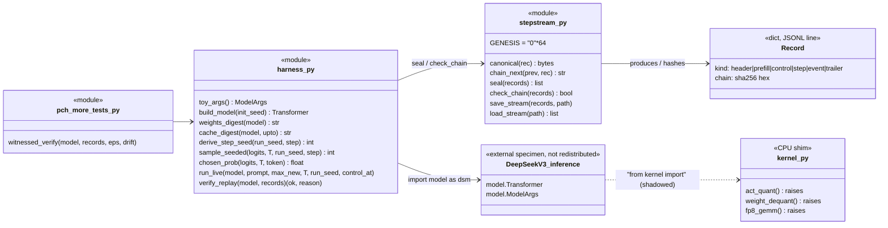
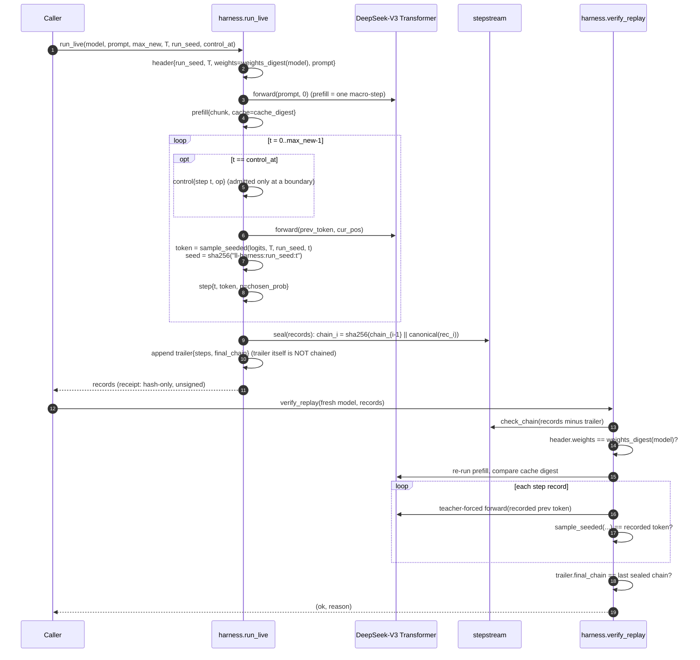
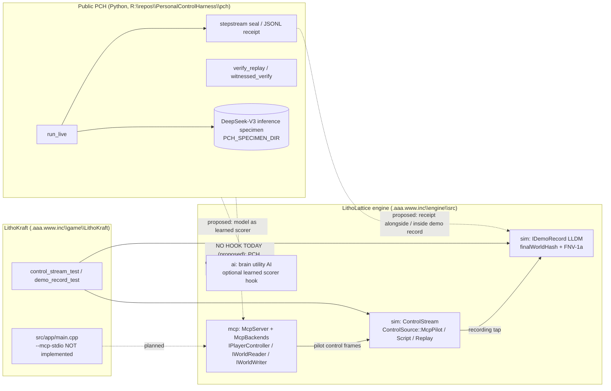

# PCH — UML and Engine/Game Hooks

*Read-only analysis, 2026-10-23. Sources: `R:\repos\PersonalControlHarness` (public PCH, `pch/` folder) and `C:\Users\jdwetwork\.aaa.www.inc\engine` / `game\LithoKraft`. No CEF/shell-layer code, key files or private PCH contents were opened. Every claim cites a file; where something does not exist, it says so.*

Path shorthand: `PCH/` = `R:\repos\PersonalControlHarness\pch\`, `ENG/` = `C:\Users\jdwetwork\.aaa.www.inc\engine\`, `GAME/` = `C:\Users\jdwetwork\.aaa.www.inc\game\LithoKraft\`.

## 1. PCH modules and types

The PCH is a small Python prototype, not a class hierarchy. It has no classes, just module-level functions over plain dict records.

- `PCH/harness/stepstream.py`: the record format (kinds `header`, `prefill`, `control`, `step`, `event`, `trailer`; docstring lines 1–15) plus `canonical`, `chain_next`, `seal`, `check_chain`, `save_stream`, `load_stream`. The chain is `sha256(prev_chain || canonical_json(record))` from `GENESIS = "0"*64`.
- `PCH/harness/harness.py`: `toy_args`, `build_model`, `weights_digest`, `cache_digest`, `derive_step_seed`, `sample_seeded`, `chosen_prob`, `run_live`, `verify_replay`. It imports the DeepSeek-V3 `inference/model.py` "specimen" from `PCH_SPECIMEN_DIR` (or `../DeepSeek-V3/inference`), and that code is never modified or shipped (lines 16–33).
- `PCH/harness/kernel.py`: a CPU shim that stands in for the specimen's Triton `kernel` module. `act_quant`, `weight_dequant` and `fp8_gemm` all raise if they're reached, so it runs on bf16 only.
- `PCH/harness/pch_more_tests.py`: `witnessed_verify(model, records, eps, drift)`, the cross-hardware "Witnessed Replay" tier Argon proposed (`PCH/docs/Pillar-PlugIn-Map.md`, Addendum 1).
- `PCH/harness/verify_streams.py` and `disc_test_llm.py`: verification and test scripts over the shipped `stream_greedy.jsonl` and `stream_sampled.jsonl`.
- Test beds: `R:\repos\PersonalControlHarness\testbeds\` (`receipt_check.py`, `tb_*.py`, `pch_testlib.py`).

## 2. Sequence: one sealed run, then replay/verify

Source: `PCH/harness/harness.py` `run_live` and `verify_replay`, plus `PCH/harness/stepstream.py`.

Notes:
- The trailer is appended after `seal()` and so isn't hash-covered. `verify_replay` only compares `final_chain` with the last chain value and never checks `steps` (see `harness.py` `run_live`/`verify_replay`). This matches the fuzz finding on the `testbeds-and-buildenv` branch, which is reported in `testbeds/SUMMARY.md`.
- The `event` record kind is defined in `stepstream.py` but never emitted by `run_live`.
- No signing exists. Receipts are hash chains only (`stepstream.py`).

## 3. Where the PCH meets the engine and game today

**Plainly: there is no real hook today.** Nothing under `ENG/src`, `ENG/docs` or `GAME/src` refers to PCH, ControlHarness, DeepSeek or the step-stream (I grepped for `PCH|ControlHarness|Personal Control|receipt|DeepSeek|stepstream`). The PCH runs as a standalone Python process. A copy of it also lives in `R:\repos\PersonalControlHarness\harness\` next to `pch/`.

What the engine does have are three seams designed in the same "serialized stream" style. A PCH would plug in through them:

- **ControlStream** (`ENG/src/sim/include/litholattice/sim/control_stream.h`): every sim-affecting input crosses one stream stamped `(seq, tick)` and is applied at the POST phase. The world is "a pure function of (initial state, stamped stream)" (lines 1–24). `ControlSource` already has `McpPilot`, `Script`, `Replay` and `Test` (lines 37–43). It offers `submit()` and `submitStamped()` plus a recording tap.
- **IDemoRecord** (`ENG/src/sim/include/litholattice/sim/idemo_record.h`): the `LLDM` file of LLCS segments, with a trailer carrying `finalWorldHash` and an FNV-1a checksum. That's the game-side analogue of a PCH receipt (FNV-1a, not SHA-256, and also unsigned).
- **MCP server** (`ENG/src/mcp/`, `server.h` `McpBackends` and the `I*` seams such as `IPlayerController`, `IWorldReader`, `IWorldWriter`). `ENG/docs/MCP-GAME-SEAM.md` states that the game-side `--mcp-stdio` wiring is "Nothing here is implemented yet" and that Phase 4 writes go through `IWorldWriter` onto the sim thread.
- **Engine AI** (`ENG/src/ai/include/litholattice/ai/brain.h`): deterministic utility AI and behaviour trees "with an optional learned scorer hook" (lines 1–2). It's a possible in-game seat for model decisions, but it isn't connected to the PCH.

Dashed edges are proposals. The design intent behind them is written up in `PCH/docs/Pillar-PlugIn-Map.md`: Pillars 1–3, the verification request/verdict carried as events and control in one stream, and "the same rule the game sim already lives by".

## 4. Option: PCH loaded via hardware CEF layer (Proposed by JD)

*This is a design sketch from JD's description only ("if you hook the PCH to the hardware CEF layer, it's a different kind of thing and can always be loaded with the engine and local model weights"). No CEF or shell-layer code was read, so nothing here describes how that layer actually works.*

**Idea:** the PCH stops being an optional side process and becomes a resident service in the CEF layer. It would load whenever the engine loads, with local model weights held alongside it.

**Pros**
- It's always there. Every model-driven act in the game could go through the step-boundary gate, rather than only when someone runs the Python harness.
- One place to load and attest the weights. `weights_digest` (`harness.py`) could be computed once at load and stamped into every receipt.
- It fits the existing design. ControlStream is already "one stream, one sequencer" (`control_stream.h`), and a resident PCH could feed it as a dedicated `ControlSource`.

**Cons / risks**
- The public/private split gets harder. The CEF/shell layer is private, but the PCH is public MIT, so a CEF-resident PCH means either a public interface with a private host or a fork. The private PCH folder under `.aaa.www.inc` already exists, though I only listed it.
- Runtime: today's PCH is Python plus torch, bf16 on CPU only (`kernel.py`). The engine is C++. Running it resident means either embedding Python or porting it to C++ or ONNX-style inference.
- Memory and startup cost of keeping the weights resident with the engine.
- Its failure modes are now the engine's. A harness fault could block engine startup unless it's isolated.

**Open questions**
1. **Load order:** does the PCH load before the engine, so it can gate the first tick, or after it? What happens to the engine if the weights are missing?
2. **Weights residency:** shared memory, a separate process, or in-process? Who owns the GPU or CPU budget versus the renderer?
3. **Determinism:** the engine sim is tick-quantized (`control_stream.h`), while the PCH is token-step-quantized (`harness.py`). How do PCH steps map to world ticks? The Map's honest blockers also apply: same-hardware replay vs Witnessed Replay across hardware (`Pillar-PlugIn-Map.md`, Argon Addendum 1).
4. **Receipts:** should there be one combined record (PCH SHA-256 chain plus LLDM FNV-1a, `idemo_record.h`) or two linked ones? The trailer-coverage fix and signing (S1–S5, PCH core) would be needed first, and both need JD's go.
5. **Public vs private:** which part is the public "PCH API", and which stays in the private CEF host?
6. **Threading:** MCP and other producers never mutate the world directly (`MCP-GAME-SEAM.md`). Does a resident PCH follow the same rule and submit only through ControlStream?
